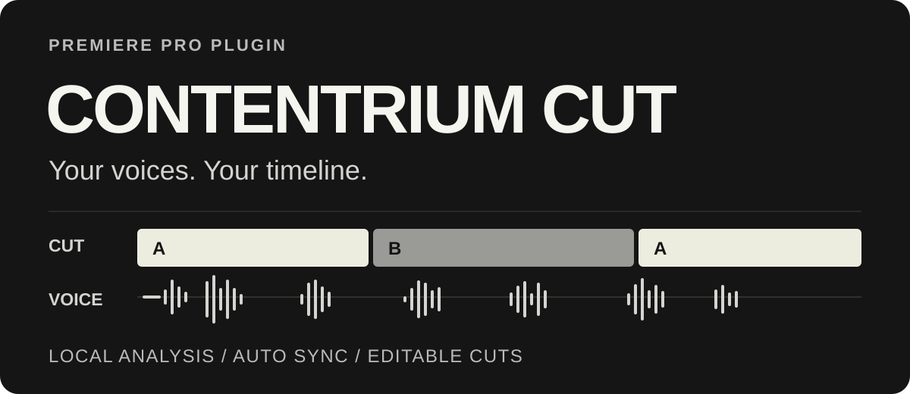
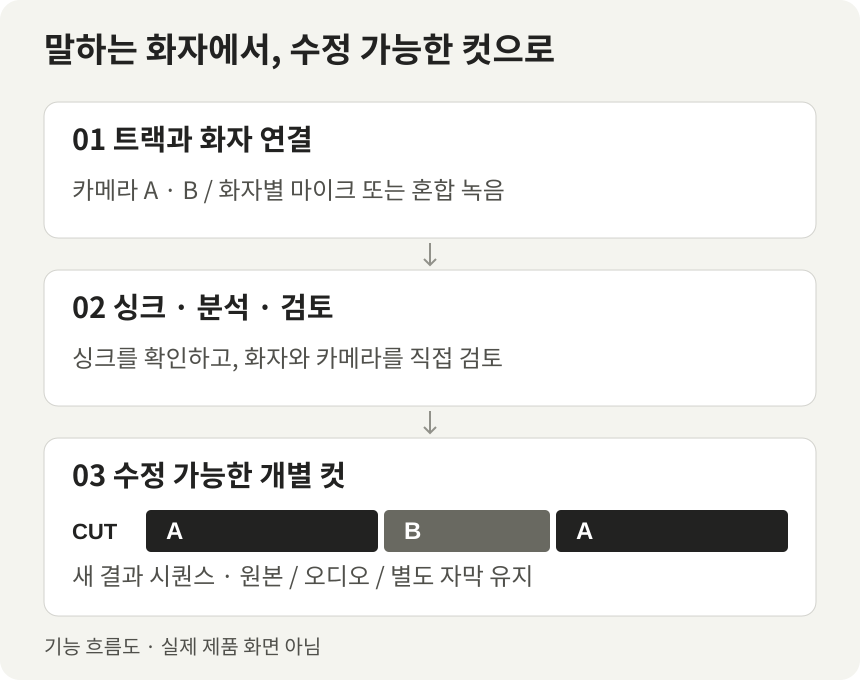

# Contentrium CUT

말하는 화자에 맞춰 카메라를 선택하고, Premiere Pro에서 계속 다듬는 **컷 편집 플러그인**입니다. 트랙 설정부터 싱크, 화자 분석, 컷 검토까지 하나의 패널에서 진행합니다.

**[온라인 설치기 다운로드](https://github.com/contentriumkorea/contentrium-cut/releases/latest/download/Contentrium-CUT-Install.exe)** · **[압축형 수동 구성 다운로드](https://github.com/contentriumkorea/contentrium-cut/releases/latest/download/Contentrium-CUT-Portable-Windows-x64.zip)** · [현재 버전 0.1.109](https://github.com/contentriumkorea/contentrium-cut/releases/tag/v0.1.109)

대상 환경: **Windows x64 · Premiere Pro 26.5.2**. 처음 사용하는 PC에서는 약 17MB의 온라인 설치기를 실행하고, 파일 준비 후 Premiere에서 패널을 열어 첫 연결을 마칩니다.

> Premiere 플러그인이므로 압축형 구성도 최초 패널 등록과 보안 연결이 필요합니다. 완전 무설치 포터블 앱은 아닙니다. 이미 설치했다면 패널의 **업데이트**를 사용하세요.

## 핵심 기능

| 기능 | 할 수 있는 일 |
| --- | --- |
| 트랙별 설정과 싱크 | 카메라·마이크·채널·사용 범위를 지정하고 자동·수동·타임코드 싱크를 설정합니다. |
| 화자 중심 컷 | 화자별 마이크 또는 혼합 녹음을 분석하고, 화자와 카메라를 연결해 편집안을 검토합니다. |
| 계속 수정하는 결과 | 새 결과 시퀀스의 최상단 **Contentrium CUT** 영상 트랙에 개별 컷을 만듭니다. 원본·오디오·별도 자막은 보존합니다. |
| 로컬 분석 | 준비한 모델로 오디오를 PC에서 분석합니다. 원음·프로젝트·화자 정보를 GitHub로 보내지 않습니다. |

## 사용 예시

*위 이미지는 기능 흐름도이며 실제 제품 화면이 아닙니다.*

1. **트랙**에서 카메라와 마이크를 연결하고 싱크를 확인합니다.
2. **화자 → 컷 편집 → 검토**에서 이름·카메라·최소 샷 길이 등을 설정하고 불확실한 구간을 교정합니다.
3. 결과를 적용한 뒤 Premiere에서 각 컷을 계속 수정합니다. 로고 배치와 추가 그래픽 편집은 사용자가 직접 합니다.

## 설치

1. **온라인 설치기**를 실행하고 **다운로드 및 설치**를 누릅니다. 실행 시점의 최신 정식 버전을 찾아 파일을 내려받고 검증합니다.
2. 전체 설치 창의 안내에 따라 프로젝트를 저장하고 Premiere를 정상 종료한 뒤 설치를 진행합니다.
3. Premiere의 **Window → UXP Plugins → Contentrium CUT**을 열어 첫 연결을 마칩니다.

[자세한 설치·실패 진단·수동 구성 안내](docs/installation.md)

## 업데이트와 데이터 보존

패널의 **업데이트**를 누르면 즉시 새 작업을 차단하고 중단을 요청합니다. 진행 중인 작업이 끝나고 Premiere가 정상 종료된 뒤 파일을 교체합니다. 중단된 편집은 자동으로 재개하지 않습니다.

혼합 녹음 모델은 제공자 계정의 접근 권한과 이용 조건 동의가 필요하며 별도로 준비합니다. [모델·개인정보와 지원 범위](docs/installation.md#모델과-개인정보)를 확인하세요.

실제 다른 PC의 설치 성공, Premiere 첫 연결·편집, Community-1의 실제 화자 구분 품질은 아직 미검증입니다. 검증하지 않은 호스트 버전이나 미디어 구성의 편집 적용은 차단합니다.

버전 변경 사항·검증 자료·개발 안내

- **0.1.109:** 다운로드 진행률·용량·속도·남은 시간, 오류 코드·진단 복사·재시도, 설치 아이콘을 개선했습니다. [변경 사항](docs/releases/0.1.109.md)
- [패키지·공개 다운로드 검증](docs/qa/distribution-0.1.109-public-proof.json) · [설치 개선 검증](docs/qa/installer-feedback-0.1.109.md)
- [설계와 검증 범위·개발 안내](docs/development.md) · [기존 0.1.0 전환 안내](docs/source-assisted-migration.md)
- [제3자 라이선스·귀속 자료](licenses/)와 패널의 `vendor/` 고지를 유지합니다.

